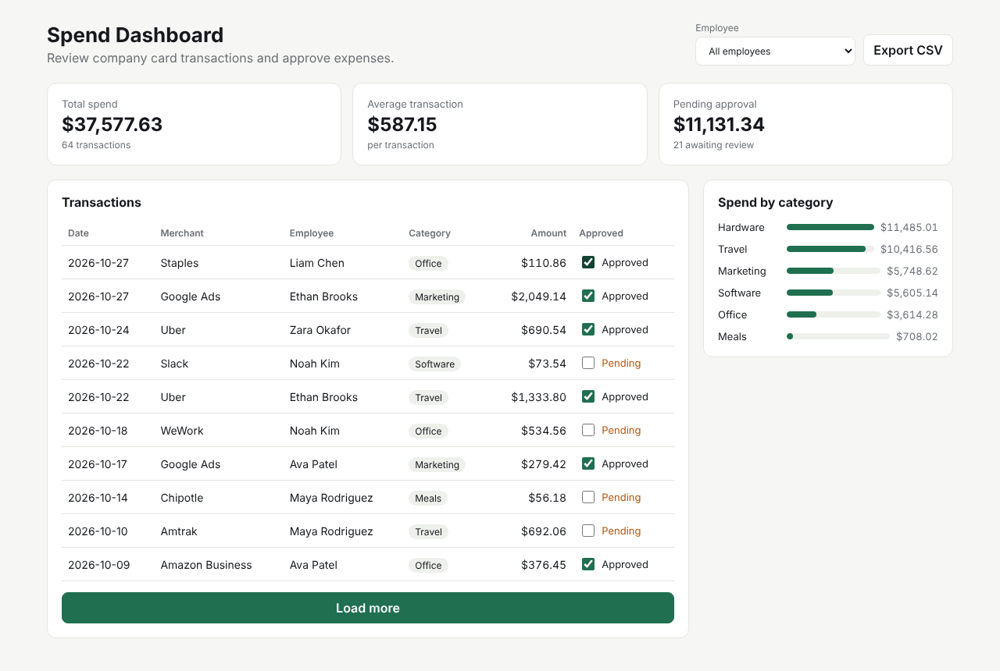
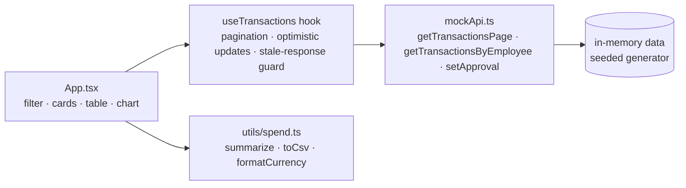

# Spend Dashboard


   

A corporate-card **expense management dashboard** built with React + TypeScript. Finance teams can browse
company card transactions, filter by employee, approve or flag expenses, see spend by category, and export to CSV.
Data comes from a mock REST API with realistic network latency, so all the async edge cases of a real app
(loading states, pagination, race conditions, failed updates) are handled.



## Features

- **Paginated transaction list** — "Load more" *appends* the next page (10 per page) and hides when there's nothing left
- **Employee filter** — switch between all employees and one employee; the summary and chart follow the filter
- **Approve / un-approve** with **optimistic updates** and automatic **rollback** if the API call fails
- **Summary cards** — total spend, average transaction, amount pending approval
- **Spend by category** chart (pure CSS, no chart library)
- **Export CSV** of the current view (properly escaped)
- **Race-condition safe** — responses from an outdated filter are ignored if the user switches quickly
- Responsive layout, accessible labels on controls, error banner via `role="alert"`

## Architecture



The UI only talks to `api.*` functions, so the mock can be swapped for real `fetch` calls without touching components.

## Run it

```bash
yarn install
yarn dev        # http://localhost:5173
yarn test       # Vitest: pagination, filtering, approval persistence, summary math, CSV escaping
yarn build
```
Set `VITE_API_LATENCY_MULTIPLIER` in a local `.env` to control the simulated network delay (default `1`, `0` = instant).

## Project structure

```
src/
  App.tsx                       page layout + employee filter + CSV export
  hooks/useTransactions.ts      data loading, pagination, optimistic approval with rollback
  api/mockApi.ts                mock REST API with latency (+ tests)
  api/data.ts                   deterministic sample data (seeded PRNG)
  components/                   SummaryCards, TransactionsTable, CategoryBreakdown
  utils/spend.ts                summary + CSV helpers (+ tests)
```

## Interview talking points

- **Pagination bug class:** replacing instead of appending pages, or showing "Load more" after the last page / while filtered — handled in the hook and covered by tests.
- **Stale responses:** a request counter (`requestId`) drops responses from an old filter.
- **Optimistic UI:** update local state immediately, call the API, roll back + show an error on failure.
- **Cache consistency:** approval changes update both the visible page and the summary scope so numbers never disagree.
- **Next steps:** server-side filtering & search, URL-synced filters, virtualised table for large datasets, bulk approve, Playwright e2e tests.
